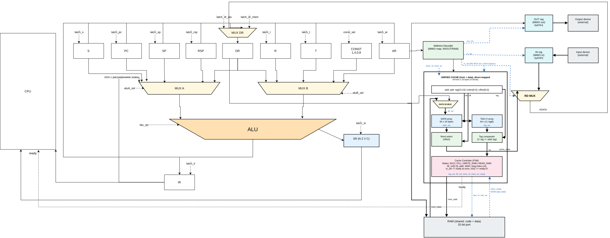
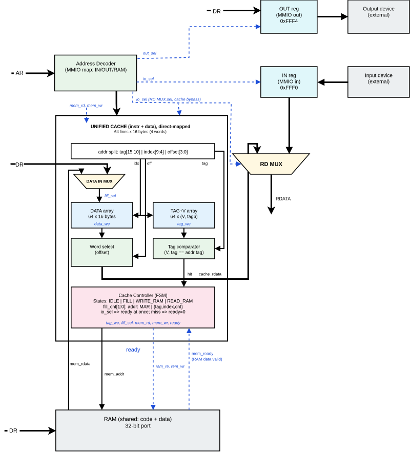
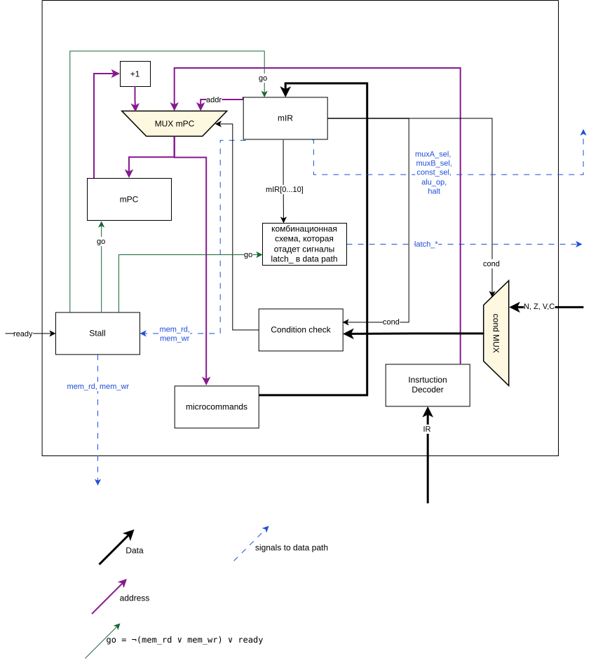

# Лабораторная работа №4. Эксперимент

**Forth, стековый процессор с микрокодом и кешем**

- Кобленц Мария Алексеевна
- Группа: P3206
- Вариант:

```text
forth | stack | neum | mc | stream | mem | pstr | cache | alg1
```
## Оглавление

- [Особенности варианта](#особенности-варианта)
- [Установка и запуск](#установка-и-запуск)
- [Язык программирования](#язык-программирования)
  - [Синтаксис](#синтаксис)
  - [Семантика](#семантика)
  - [Слова языка](#слова-языка)
  - [Выполнение на бумаге](#выполнение-на-бумаге)
- [Организация памяти](#организация-памяти)
  - [Модель памяти](#модель-памяти)
  - [Карта памяти](#карта-памяти)
  - [Стек данных](#стек-данных)
  - [Стек возвратов](#стек-возвратов)
  - [Размещение программы и данных](#размещение-программы-и-данных)
- [Система команд](#система-команд)
  - [Общее описание](#общее-описание)
  - [Кодирование инструкций](#кодирование-инструкций)
  - [Набор инструкций](#набор-инструкций)
  - [Время выполнения инструкций](#время-выполнения-инструкций)
  - [Циклы со счётчиком на уровне инструкций](#циклы-со-счётчиком-на-уровне-инструкций)
- [Транслятор](#транслятор)
  - [Запуск](#запуск)
  - [Этапы работы](#этапы-работы)
  - [Правила генерации кода](#правила-генерации-кода)
  - [Пример](#пример)
  - [Ошибки трансляции](#ошибки-трансляции)
- [Модель процессора](#модель-процессора)
  - [DataPath](#datapath)
  - [Control Unit и микрокод](#control-unit-и-микрокод)
  - [Память и кеш](#память-и-кеш)
  - [Особенности моделирования](#особенности-моделирования)
- [Тестирование](#тестирование)
  - [Golden-тесты](#golden-тесты)
  - [Набор тестов](#набор-тестов)
  - [Результаты](#результаты)
  - [Пример работы инструментов](#пример-работы-инструментов)
  - [CI и линтеры](#ci-и-линтеры)
- [Влияние кеша на производительность](#влияние-кеша-на-производительность)
- [Ограничения](#ограничения)
- [Структура репозитория](#структура-репозитория)

## Особенности варианта
- `forth` -- синтаксис языка Forth с обратной польской нотацией.
    - Требуется поддержка процедур.
    - Требуется поддержка `execution token`.
- `stack` -- система команд должна быть стековой:
    - Вместо регистров используется стек.
    - Это не исключает и не заменяет наличие памяти команд и памяти данных.
- `neum` -- фон Неймановская архитектура.
- `mc` -- microcoded.
    - В отчёте необходимо задокументировать уровень микроинструкций.
    - Микрокод должен быть сохранён в отдельной памяти для микропрограмм.
    - Модель процессора должна исполнять микрокод.
- `stream`
    Ввод-вывод осуществляется как поток токенов (как во Wrench). Есть в примере. Логика работы:
    - При старте модели у вас есть буфер, в котором представлены все данные ввода (`['h', 'e', 'l', 'l', 'o']`).
    - При обращении к вводу (выполнение инструкции) модель процессора получает "токен" (символ) информации.
    - Если данные в буфере кончились -- останавливайте моделирование.
    - Вывод данных реализуется аналогично, по выполнении команд в буфер вывода добавляется ещё один символ.
    - По окончании моделирования показать все выведенные данные.
    - Логика работы с буфером реализуется в рамках модели на Python.
- `mem` -- memory-mapped (порты ввода-вывода отображаются в память и доступ к ним осуществляется штатными командами),
    - отображение портов ввода-вывода в память должно конфигурироваться (можно hardcode-ом).
- `pstr` -- Length-prefixed (Pascal string)
- `alg1` -- `is_prime`, `format_string`.
- `cache` -- работа с памятью реализуется через кеш.
    - Скорость доступа к кешу -- 1 такт, к памяти -- 10 тактов.
    - Необходимо реализовать алгоритм, демонстрирующий работу с кеш памятью и её влияние на производительность -- подойдёт `linear_filter` из [wrench variants](https://github.com/ryukzak/wrench/blob/master/variants.md) (повторное чтение соседних элементов окна создаёт заметную временную локальность).
---
## Установка и запуск:

```shell
python3 -m venv .venv && . .venv/bin/activate
pip install pytest pyyaml types-PyYAML ruff mypy

mkdir -p out
python3 -m translation.translator examples/hello.fs out/hello.bin
python3 machine.py out/hello.bin examples/empty_input.txt
```

Параметры модели: `machine.py <образ.bin> <ввод.txt> [--no-cache] [--limit N] [--journal файл]`.

- `--no-cache` отключает кеш (нужно для сравнения тактов);
- `--limit N` останавливает модель после `N` тактов;
- `--journal файл` пишет журнал, одна строка на такт.

Тесты и проверки: `pytest -v`, `ruff check .`, `ruff format --check .`, `mypy`.

---

## Язык программирования

### Синтаксис

Синтаксис в расширенной форме Бэкуса-Наура. Слова разделяются пробелами и переводами строк, регистр букв различается.

```ebnf
program     ::= { top_item } ;

top_item    ::= definition | data_decl | include | statement ;

include     ::= "include" file_name ;

definition  ::= ":" name { item } ";" ;

data_decl   ::= "variable" name
              | "create" name
              | number "constant" name
              | number "allot"
              | number "," ;

statement   ::= number | name | string_lit | tick ;

item        ::= number | name | string_lit | tick | char_lit | "recurse" | control ;

control     ::= "if" { item } [ "else" { item } ] "then"
              | "begin" { item } "until"
              | "begin" { item } "again"
              | "begin" { item } "while" { item } "repeat"
              | "do" { item } "loop"
              | "?do" { item } "loop" ;

tick        ::= ( "'" | "[']" ) name ;
char_lit    ::= ( "[char]" | "char" ) char ;
string_lit  ::= 's"' text '"' | '."' text '"' ;

number      ::= [ "-" ] digit { digit } | "0x" hex { hex } | "$" hex { hex } ;
comment     ::= "\" { any_char } end_of_line | "(" { any_char } ")" ;
```

Комментарии выбрасываются при разборе текста. После `s"` и `."` стоит один пробел, а сама строка кончается на первой закрывающей кавычке. `[char]` работает только внутри определений.

### Семантика

**Как вычисляется программа.** Число кладёт себя на стек, слово берёт со стека свои аргументы и кладёт результат. Запись `a b +` выполняется слева направо: сначала `a`, потом `b`, потом сложение. Определение `: имя ... ;` превращается в подпрограмму, использование имени это её вызов, а `;` и `exit` возвращают управление.

Сначала загружаются все определения. Потом по порядку выполняется то, что записано вне определений: это главная часть программы. В конце стоит `bye`, а если его нет, транслятор допишет остановку сам.

**Видимость.** Словарь один, глобальный. Слово можно использовать сразу после `:`, поэтому рекурсия работает и по имени, и через `recurse`. Если назвать своё слово так же, как встроенное, победит своё. Локальных переменных нет: промежуточные значения лежат на стеках.

**Типы.** Типов нет. Любое значение это 32-битное слово. Числа знаковые или беззнаковые определяется операцией (`<` знаковое сравнение, `u<` беззнаковое). Результат сравнения: `-1` (истина) или `0` (ложь). Адрес это обычное число. Один символ занимает одно слово.

**Литералы:**

| Вид | Запись | Значение |
|---|---|---|
| Десятичное число | `42`, `-5` | число |
| Шестнадцатеричное | `0xFF`, `$FF` | число |
| Символ | `[char] A` | код символа (65) |
| Строка | `s" text"` | адрес строки (pstr) в памяти данных |
| Печатаемая строка | `." text"` | то же и вызов печати строки (слово `pstr-type` из библиотеки) |
| Имя константы | `max-n` | значение константы |

**Слова времени трансляции.** Эти слова работают вне определений и выполняются транслятором, а не процессором:

| Слово | Что делает |
|---|---|
| `include файл` | подставляет токены другого файла |
| `variable имя` | выделяет в памяти данных одно слово (нулевое) и называет его адресом |
| `create имя` + `n allot` | выделяет `n` байт (кратно 4), имя возвращает адрес начала |
| `n ,` | добавляет в память данных слово со значением `n` |
| `n constant имя` | константа, подставляется как литерал |
| `cells` | умножает число на 4 (при применении вне определений вычисляется при трансляции) |

`allot` и `,` нужно писать сразу после `create`.

**Execution token.** Слово `'` (внутри определения `[']`) кладёт на стек адрес слова, то есть адрес его первой инструкции. Слово `execute` снимает адрес со стека и вызывает слово по нему. Адрес можно взять только у слов, определённых через `:`, и у переменных.

**Управляющие конструкции:**

| Конструкция | Что происходит |
|---|---|
| `if A else B then` | снимает флаг; если 0, выполняется `B`, иначе `A` |
| `begin A until` | повторять `A`, пока снятый флаг равен 0 |
| `begin A again` | бесконечный цикл |
| `begin A while B repeat` | повторять, пока флаг после `A` не равен 0 |
| `limit start do A loop` | цикл со счётчиком от `start` до `limit-1` (верхняя граница не включается), `i` даёт текущий индекс |
| `limit start ?do A loop` | то же, но при `limit = start` цикл пропускается |

### Слова языка

| Группа | Слова |
|---|---|
| Стек данных | `dup drop swap over rot 2dup 2drop` |
| Арифметика | `+ - * / mod 1+ 1- negate` (деление знаковое, с усечением к нулю) |
| Логика, сдвиги | `and or xor invert lshift rshift` (`rshift` логический) |
| Сравнения | `= <> < > <= >= u< 0= 0< 0>` |
| Память | `@ !` (слово по адресу) |
| Стек возвратов | `>r r> r@ i` |
| Управление | `execute exit recurse bye` |
| Ввод-вывод | `key` (прочитать символ), `emit` (вывести символ), `cr`, `space` |
| Константы | `true` (−1), `false` (0) |

**Библиотека `examples/lib.fs`** (на самом Forth): `digit?`, `read-num` (число без знака), `read-int` (со знаком), `print-num`, `pstr-type` (печать pstr), `read-pstr` (чтение строки до перевода строки в pstr).

### Выполнение на бумаге

Программа `3 4 + dup *`, вершина стека справа:

| Слово | Стек |
|---|---|
| `3` | `3` |
| `4` | `3 4` |
| `+` | `7` |
| `dup` | `7 7` |
| `*` | `49` |

С определением: после `: sq dup * ;` строка `5 sq` кладёт 5, вызывает `sq`, там `dup` даёт `5 5`, `*` даёт `25`, `;` возвращает управление.

---

## Организация памяти

### Модель памяти

Слово 32 бита. Память байтовая, 64 КиБ (`0x0000`–`0xFFFF`), общая для кода, данных и обоих стеков (фон Нейман). Порт у неё один, значит за такт возможно одно обращение.

Читать и писать можно только целыми словами по адресам, кратным 4. Невыровненное обращение это ошибка, модель останавливается. Всё, кроме портов ввода-вывода, идёт через кеш.

Регистры процессора, с которыми работают микропрограммы (программист на Forth видит только стеки):

| Регистр | Что хранит |
|---|---|
| `T` | вершина стека данных |
| `S` | второй элемент стека данных |
| `SP` | адрес первой свободной ячейки стека данных в памяти |
| `R` | вершина стека возвратов |
| `RSP` | адрес первой свободной ячейки стека возвратов в памяти |
| `PC` | адрес следующей инструкции |
| `IR` | текущая инструкция |
| `AR` | адрес обращения к памяти |
| `DR` | данные обращения к памяти |
| `SR` | флаги `N`, `Z`, `V`, `C` |

Инструкции, процедуры и данные лежат в одном образе подряд, отдельных областей под них нет. Прерываний в работе нет, потому что у варианта `stream`.

### Карта памяти

```text
0x0000  ┌──────────────────────────────┐
        │ jmp <точка входа>            │  всегда первая инструкция
        │ код определений слов         │
        │ код главной части (entry)    │  заканчивается halt
        ├──────────────────────────────┤
        │ статические данные           │  строки pstr, переменные,
        │                              │  буферы, литералы > 24 бит
        ├──────────────────────────────┤  граница образа: 0xE000 (максимум)
        │ свободная память             │
        │                              │
0xF7FC  │ стек данных  (растёт вниз)   │  SP при старте
        │                              │
0xFB7C  │ стек возвратов (растёт вниз) │  RSP при старте
        │                              │
0xFFF0  │ порт ввода (чтение)          │
0xFFF4  │ порт вывода (запись)         │
0xFFFF  └──────────────────────────────┘
```

Образ не может быть больше `0xE000` байт, между его концом и стеком данных остаётся около 6 КиБ под рост стека. Стек возвратов растёт вниз от `0xFB7C`, и примерно на 220-й вложенности он дойдёт до вершины стека данных. Границы стеков не проверяются.

Адреса начала стеков выбраны так, чтобы они не попадали в одну строку кеша. 

### Стек данных

Первый элемент `T` и второй `S` лежат в регистрах, третий и все следующие в памяти, начиная с адреса `SP + 4`. `SP` указывает на первую свободную ячейку, стек растёт вниз.

Правила:

| Действие | Что происходит |
|---|---|
| положить значение `x` | `MEM[SP] ← S`, `SP ← SP − 4`, `S ← T`, `T ← x` |
| снять значение | `T ← S`, `S ← MEM[SP + 4]`, `SP ← SP + 4` |
| бинарная операция `⊕` | `T ← S ⊕ T`, потом снять значение |
| `swap` | `T` и `S` меняются местами, память не трогается |

Глубину стека модель не отслеживает. При старте `T = S = 0`, и пустой стек выглядит как стек, в котором лежат два нуля. Снять значение с пустого стека это ошибка программы, но модель её не заметит.

### Стек возвратов

Устроен так же, только регистр один: `R` хранит верхний элемент, остальное лежит в памяти по `RSP`.

| Действие | Что происходит |
|---|---|
| `call X` | `MEM[RSP] ← R`, `RSP ← RSP − 4`, `R ← PC`, `PC ← X` |
| `ret` | `PC ← R`, `R ← MEM[RSP + 4]`, `RSP ← RSP + 4` |
| `>r` | `MEM[RSP] ← R`, `RSP ← RSP − 4`, `R ← T`, затем снять значение со стека данных |
| `r>` | положить `R` на стек данных, затем `R ← MEM[RSP + 4]`, `RSP ← RSP + 4` |

В `call` в `R` попадает `PC`, который уже указывает на следующую за вызовом инструкцию. Ей и вернёмся.

### Размещение программы и данных

**Литералы.** Если число влезает в 24 бита со знаком (от −8 388 608 до 8 388 607), оно кладётся прямо в операнд `push`. Остальные числа транслятор складывает в память данных (одинаковые хранятся один раз) и вместо одной инструкции пишет две: `push <адрес>` и `load`. Литералов из нескольких слов нет: 64-битное число программа хранит двумя словами сама (см. `examples/double.fs`).

**Строки.** `s" Hello"` в памяти данных превращается в слово с длиной и пять слов с кодами символов. В коде остаётся только `push <адрес>`. Одинаковые строки хранятся один раз, строки идут в порядке первого появления в программе.

**Константы** в памяти не лежат. Транслятор запоминает значение, а каждое использование заменяет на `push значение`.

**Переменные и буферы** лежат в статической памяти в порядке объявления. `variable x` занимает одно слово, `create buf n allot` занимает `n` байт. В коде имя превращается в `push <адрес>`. Регистров общего назначения нет, так что переменных в регистрах тоже нет, а временные значения программа держит на стеках.

**Инструкции** лежат с адреса 0. Первой всегда идёт `jmp` на главную часть, дальше определения слов в порядке записи, потом главная часть. Данные начинаются сразу за кодом.

**Процедуры.** Слово `: имя ... ;` это непрерывный кусок кода, который кончается `ret`. Вызывается инструкцией `call`, адрес возврата идёт на стек возвратов. Рекурсия ограничена только размером стека.

**Порты ввода-вывода.** Лежат в памяти по `0xFFF0` (чтение отдаёт код следующего символа) и `0xFFF4` (запись добавляет символ в вывод). Адреса заданы константами в `isa.py`. Слово `key` превращается в `push 0xFFF0` и `load`, слово `emit` в `push 0xFFF4` и `store`. Кеш в этих обращениях не участвует.

---

## Система команд

### Общее описание

Система команд стековая. Все инструкции по 32 бита, управляет ими микрокод. Данные одного вида: 32-битное слово.

- Адресация абсолютная (у `call`, `jmp`, `jz`, `jnz`), непосредственная (у `push`) и стековая (у остальных). Адрес для `@` и `!` берётся со стека.
- Ввод-вывод отображён в память и отдельных инструкций не имеет.
- После выборки инструкции `PC` увеличивается на 4. Переходы безусловные и условные, вызовы идут через стек возвратов.
- Прерываний нет.

### Кодирование инструкций

```text
 31      24 23                           0
┌──────────┬───────────────────────────────┐
│  опкод   │ операнд (24 бита, со знаком)  │
└──────────┴───────────────────────────────┘
```

Операнд нужен только `push`, `call`, `jmp`, `jz` и `jnz`, у остальных инструкций он равен нулю. Перед подачей в АЛУ знак операнда расширяется до 32 бит.

Образ в файле это слова подряд, младший байт первым (little-endian).

### Набор инструкций

| Опкод | Команда | Слово Forth | Что делает | Микрокоманд | Тактов, минимум |
|---|---|---|---|---|---|
| `00` | `halt` | `bye` | остановка | 1 | 5 |
| `01` | `dup` | `dup` | положить копию `T` | 4 | 17 |
| `02` | `drop` | `drop` | снять значение | 4 | 8 |
| `03` | `swap` | `swap` | поменять `T` и `S` (через `DR`) | 3 | 7 |
| `04` | `over` | `over` | положить копию `S` | 5 | 18 |
| `05` | `ret` | `;`, `exit` | вернуться из подпрограммы | 4 | 8 |
| `06` | `tor` | `>r` | со стека данных на стек возвратов | 8 | 21 |
| `07` | `fromr` | `r>` | со стека возвратов на стек данных | 8 | 21 |
| `08` | `rfetch` | `r@`, `i` | положить копию `R` на стек данных | 5 | 18 |
| `09` | `exec` | `execute` | вызвать слово по адресу из `T` | 9 | 22 |
| `0A` | `push imm` | литерал | положить константу (24 бита) | 5 | 18 |
| `10` | `call addr` | имя слова | вызвать подпрограмму | 5 | 18 |
| `11` | `add` | `+` | `T ← S + T` | 4 | 8 |
| `12` | `sub` | `-` | `T ← S − T` | 4 | 8 |
| `13` | `mul` | `*` | `T ← S × T`, знаковое | 4 | 8 |
| `14` | `div` | `/` | `T ← S / T`, знаковое, к нулю | 4 | 8 |
| `15` | `mod` | `mod` | `T ← S mod T` | 4 | 8 |
| `16` | `and` | `and` | `T ← S & T` | 4 | 8 |
| `17` | `or` | `or` | `T ← S \| T` | 4 | 8 |
| `18` | `xor` | `xor` | `T ← S ^ T` | 4 | 8 |
| `19` | `eq` | `=` | `T ← (S = T) ? −1 : 0` | 7 | 11 |
| `1A` | `lt` | `<` | знаковое `S < T` | 7 | 11 |
| `1B` | `gt` | `>` | знаковое `S > T` | 6–9 | 10–13 |
| `1C` | `ult` | `u<` | беззнаковое `S < T` | 7 | 11 |
| `1D` | `shl` | `lshift` | `T ← S << T` | 4 | 8 |
| `1E` | `shr` | `rshift` | `T ← S >> T`, логический | 4 | 8 |
| `20` | `load` | `@` | `T ← MEM[T]` | 3 | 7 |
| `21` | `store` | `!` | `MEM[T] ← S`, затем снять два значения | 9 | 22 |
| `30` | `jz addr` | `if`, `until`, `while` | переход, если `T = 0`, значение `T` снимается | 6–7 | 10–11 |
| `31` | `jmp addr` | `else`, `again`, `repeat` | безусловный переход | 1 | 5 |
| `32` | `jnz addr` | `loop` (внутри) | переход, если `T ≠ 0`, значение `T` снимается | 6–7 | 10–11 |

У `gt` и условных переходов число тактов зависит от данных. У `jz` и `jnz` 7 микрокоманд, если переход сделан, и 6, если нет. У `gt` 6 микрокоманд при равенстве, 7 если `S < T` и 9 если `S > T`.

### Время выполнения инструкций

Один такт это одна микрокоманда или один такт ожидания памяти. Полное время инструкции складывается из трёх частей:

```text
такты = 4 (выборка) + микрокоманды тела + ожидания памяти
```

Ожидания зависят от кеша:

| Обращение | Тактов |
|---|---|
| чтение, попадание в кеш | 1 |
| чтение, промах (грузится строка из 4 слов) | 40 |
| запись | 10 |
| порт ввода-вывода | 1 |
| чтение при выключенном кеше | 10 |

### Циклы со счётчиком на уровне инструкций

Отдельных инструкций для `do ... loop` нет. Индекс цикла лежит в `R`, предел под ним в памяти. Транслятор раскладывает цикл в обычные инструкции:

```text
do:      swap  >r  >r                    ; R = индекс, под ним предел
loop:    r>  push 1  add                 ; индекс + 1
         r@  over  =                     ; сравнить с пределом
         jnz done                        ; если равны, выйти
         >r  jmp body                    ; иначе вернуть индекс и повторить
done:    drop  r>  drop                  ; убрать индекс и предел
```

`i` это просто `r@`.

---

## Транслятор

### Запуск

```shell
python3 -m translation.translator <исходник.fs> <результат.bin>
```

На выходе два файла: бинарный образ памяти `<результат.bin>` и текстовый листинг `<результат.bin>.hex`, где каждая строка выглядит как `<адрес> - <слово> - <мнемоника>`. Файлы из `include` ищутся рядом с исходником.

### Этапы работы

1. **Разбиение на токены** (`translation/tokens.py`). Текст режется на слова, комментарии выбрасываются, строки `s"` и `."` становятся отдельными токенами. У токена есть вид, чтобы текст строки (например, `dup` внутри кавычек) не приняли за слово.
2. **Компиляция** (`translation/translator.py`). Токены обрабатываются по порядку. Транслятор ведёт словарь слов: имя, вид (определение через `:`, переменная или константа) и адрес или значение. Вне определений числа копятся в отдельном стеке, он нужен для `constant`, `allot` и `,`.
3. **Сборка образа** (`translation/image.py`). Определения и главная часть склеиваются, после кода идёт секция данных. Ссылки на данные заменяются настоящими адресами, а в первую инструкцию вписывается адрес главной части.
4. **Запись** образа и листинга.

### Правила генерации кода

| Что в программе | Что получается |
|---|---|
| встроенное слово | одна инструкция или короткая цепочка (`translation/primitives.py`) |
| число | `push n`, для чисел шире 24 бит `push <адрес литерала>` и `load` |
| слово, определённое через `:` | `call <адрес слова>` |
| переменная, буфер | `push <адрес>` |
| константа | `push <значение>` |
| `s" ..."` | `push <адрес строки>` |
| `." ..."` | `push <адрес строки>` и `call pstr-type` |
| `' имя`, `[']` | `push <адрес слова>` |
| `if` `else` `then` | `jz` на `else` или `then`, `jmp` на `then` |
| `begin` `until` | `jz` на начало цикла |
| `begin` `again` | `jmp` на начало цикла |
| `begin` `while` `repeat` | `jz` на конец и `jmp` на начало |
| `do`, `?do`, `loop` | цепочка из предыдущего раздела, у `?do` ещё проверка `limit = start` |
| `recurse` | `call` на начало текущего слова |
| начало образа | `jmp` на главную часть |
| конец главной части | `halt`, если `bye` не написан |

Адрес перехода вперёд в момент генерации ещё неизвестен. Поэтому транслятор запоминает номер инструкции на стеке управляющих конструкций и подставляет адрес, когда доходит до `else`, `then`, `repeat` или `loop`. Ссылки на данные (`DataRef`) заменяются настоящими адресами при сборке образа, когда известен размер кода.

### Пример

Исходник:

```forth
: sq dup * ;
5 ' sq execute
bye
```

Листинг:

```text
0000 - 31000010 - jmp 0x0010 ; entry
0004 - 01000000 - dup
0008 - 13000000 - mul
000c - 05000000 - ret
0010 - 0A000005 - push 5
0014 - 0A000004 - push 4
0018 - 09000000 - exec
001c - 00000000 - halt
```

`push 4` это `' sq`, то есть адрес слова `sq`, а `exec` это `execute`.

### Ошибки трансляции

Транслятор останавливается с сообщением (в нём номер токена), если слово неизвестно, определение или строка не закрыты, `if`, `begin` и `do` не сходятся, берётся адрес константы или встроенного слова, либо образ получился больше `0xE000` байт.

---

## Модель процессора

Модель написана на Python и точна до такта: один вызов `ControlUnit.tick()` это один такт, остановить её можно на любом. Каждому блоку схемы соответствует класс или метод.

### DataPath

Схема DataPath:



Реализован классом `DataPath` (`components/data_path.py`).

В процессоре одна шина результата: выход АЛУ подаётся на входы всех регистров. Передавать значение из регистра в регистр напрямую нельзя, для этого АЛУ работает в режиме `passA` или `passB`. За такт по шине идёт один результат, но защёлкнуть его можно сразу в несколько регистров.

Из-за этого некоторые операции занимают несколько тактов: например, чтобы поменять `T` и `S`, одно значение приходится на время записать в `DR`.

**Мультиплексор A** (`mux_a_sel`):

| Код | Источник |
|---|---|
| 0 | операнд из `IR` (24 бита со знаком, расширяются до 32) |
| 1 | `S` |
| 2 | `PC` |
| 3 | `SP` |
| 4 | `RSP` |
| 5 | `DR` |

**Мультиплексор B** (`mux_b_sel`):

| Код | Источник |
|---|---|
| 0 | `DR` |
| 1 | `R` |
| 2 | `T` |
| 3 | константа (какая, выбирает `const_sel`) |
| 4 | `AR` |

**Константы** (`const_sel`): `0 → 0`, `1 → 1`, `2 → 4`, `3 → 8`.

**АЛУ** (`alu_op`):

| Код | Операция | Код | Операция |
|---|---|---|---|
| 0 | `A + B` | 6 | `A \| B` |
| 1 | `A − B` | 7 | `A ^ B` |
| 2 | `A × B` (знаковое) | 8 | `passA` (результат `A`) |
| 3 | `A / B` (знаковое, к нулю) | 9 | `passB` (результат `B`) |
| 4 | `A mod B` | 10 | `A << (B & 31)` |
| 5 | `A & B` | 11 | `A >> (B & 31)`, логический |

Деление на ноль останавливает модель с ошибкой.

**Флаги** (`SR`, защёлкиваются сигналом `latch_sr`): `N` (старший бит результата), `Z` (результат 0), `V` (знаковое переполнение), `C` (перенос при сложении, заём при вычитании).

**Защёлки.** `latch_s`, `latch_pc`, `latch_sp`, `latch_rsp`, `latch_r`, `latch_t`, `latch_ar`, `latch_ir`, `latch_sr` записывают в регистр значение с шины. У `DR` два источника: `latch_dr_alu` берёт значение с шины, `latch_dr_mem` берёт данные из памяти.

Все регистры 32-битные, кроме `SR` (4 бита).

### Схема памяти с кэшем


### Control Unit и микрокод

Схема Control Unit:



Реализован классом `ControlUnit` (`components/control_unit.py`). Общая схема всех блоков лежит в `docs/scheme.drawio.svg`.

**Соответствие схемы и кода:**

| Блок схемы | В коде |
|---|---|
| `mPC` | `ControlUnit.mpc` |
| `mIR` | `ControlUnit.mir`, текущая микрокоманда |
| память микропрограмм | `ControlUnit.rom`, 111 микрокоманд, читается из `microcode/microcode.csv` |
| Instruction Decoder | `ControlUnit.decoder`, таблица «опкод → адрес микропрограммы» из `microcode/decoder.csv`; метод `decoder_address()` |
| мультиплексор следующего адреса | `get_next_mpc()`: либо `mPC + 1`, либо поле `addr`, либо адрес от декодера |
| мультиплексор условий | `condition_taken()`: проверяет флаги `Z`, `N`, `V`, `C` |
| Stall | переменная `waiting` в `tick()` |
| блок гашения защёлок | пока `waiting`, вызов `DataPath.tick()` пропускается |

**Формат микрокоманды** (39 бит):

| Биты | Поле | Размер | Что задаёт |
|---|---|---|---|
| 0–10 | `latch_*` | 11 | какие регистры защёлкнуть: `s, pc, sp, rsp, dr_alu, dr_mem, r, t, ar, ir, sr` |
| 11–13 | `mux_a_sel` | 3 | источник A |
| 14–16 | `mux_b_sel` | 3 | источник B |
| 17–18 | `const_sel` | 2 | константа |
| 19–22 | `alu_op` | 4 | операция АЛУ |
| 23 | `mem_rd` | 1 | запрос чтения памяти |
| 24 | `mem_wr` | 1 | запрос записи памяти |
| 25 | `halt` | 1 | остановка |
| 26–29 | `cond` | 4 | условие перехода |
| 30–38 | `addr` | 9 | адрес перехода внутри памяти микропрограмм |

**Условия перехода** (`cond`):

| Код | Имя | Переход на `addr`, если |
|---|---|---|
| 0 | `next` | никогда, идём на `mPC + 1` |
| 1 | `jmp` | всегда |
| 2 | `jz` | `Z = 1` |
| 3 | `jnz` | `Z = 0` |
| 4 | `jvs` | `V = 1` |
| 5 | `jvc` | `V = 0` |
| 6 | `jcs` | `C = 1` |
| 7 | `jcc` | `C = 0` |
| 8 | `jn` | `N = 1` |
| 9 | `jp` | `N = 0` |
| 10 | `jlv` | `N ≠ V` |
| 11 | `dispatch` | на начало микропрограммы по опкоду из `IR` |

Реально используются коды 0, 1, 2, 3, 6, 10 и 11, остальные оставлены про запас.

**Что происходит за один такт** (`ControlUnit.tick`):

1. В память уходит запрос из текущей микрокоманды: `mem_rd` или `mem_wr` с адресом из `AR` и данными из `DR`.
2. Пока память не ответила (`ready = 0`), это такт ожидания. Регистры не защёлкиваются, `mPC` не меняется, в журнале строка помечается `WAIT`.
3. Когда ответ есть, сначала считается адрес следующей микрокоманды, потом `DataPath` защёлкивает регистры, потом `mPC` и `mIR` получают новые значения. Адрес считается по старым `IR` и `SR`: в железе все регистры обновляются одним фронтом, и условие видит значения до него.
4. Микрокоманда с `halt` останавливает процессор.

**Выборка инструкции.** Одинакова для всех инструкций:

| Метка | Что делает | Сигналы |
|---|---|---|
| `fetch0` | `AR ← PC` | `A=PC`, `passA`, `latch_ar` |
| `fetch1` | `DR ← MEM[AR]`, `PC ← PC + 4` | `A=PC`, `B=const(4)`, `plus`, `latch_pc`, `latch_dr_mem`, `mem_rd` |
| `fetch2` | `IR ← DR` | `A=DR`, `passA`, `latch_ir` |
| `fetch3` | выбор микропрограммы по опкоду | `cond=dispatch` |

`fetch3` пустая специально: пока `IR` не защёлкнут, декодеру нечего смотреть. Микропрограмма инструкции в конце прыгает на `fetch0` (`cond=jmp`).

**Пример: `push`** (`mem ← S` , `S ← T` и `T ← операнд`):

| Метка | Что делает | Сигналы |
|---|---|---|
| `push0` | `AR ← SP` | `A=SP`, `passA`, `latch_ar` |
| `push1` | `DR ← S` | `A=S`, `passA`, `latch_dr_alu` |
| `push2` | `MEM[AR] ← DR`, `SP ← SP − 4` | `A=SP`, `B=const(4)`, `minus`, `latch_sp`, `mem_wr` |
| `push3` | `S ← T` | `B=T`, `passB`, `latch_s` |
| `push4` | `T ← операнд`, переход на выборку | `A=IR`, `passA`, `latch_t`, `cond=jmp → fetch0` |

Все 111 микрокоманд лежат в `microcode/microcode.csv`: метка, 39 бит и адрес перехода (метка). Таблица декодера, 31 опкод, лежит в `microcode/decoder.csv`.

### Память и кеш

Реализовано классом `MemorySystem` (`memory/memory_system.py`). Микрокод общается с ним так: `tick(AR, DR, mem_rd, mem_wr)` возвращает `(данные, ready)`. Микрокод ничего не знает про кеш и задержки, он просто держит запрос, пока не придёт `ready`.

**Параметры кеша:**

| Параметр | Значение |
|---|---|
| Организация | единый кеш для инструкций и данных |
| Отображение | прямое (direct-mapped) |
| Размер | 64 строки по 4 слова (16 байт), всего 1 КиБ |
| Политика записи | сквозная (write-through), без загрузки строки при промахе записи |
| Попадание | 1 такт |
| Обращение к RAM | 10 тактов |
| Порты ввода-вывода | в обход кеша |

**Разбиение адреса** (адрес 16 бит, память 64 КиБ):

```text
 15      10 9       4 3     2 1  0
┌──────────┬─────────┬───────┬────┐
│ tag (6)  │ index(6)│ word  │ 00 │
└──────────┴─────────┴───────┴────┘
```

`index` выбирает строку, `word` выбирает слово в строке, `tag` показывает, чью копию хранит строка. Два младших бита нулевые, потому что адреса выровнены. Адреса, отличающиеся на `0x400` (размер кеша), попадают в одну строку и выбивают друг друга.

**Как работает.** Читая слово, кеш сравнивает тег строки с тегом адреса и смотрит на бит valid. Если совпало, слово отдаётся за 1 такт. Если нет, из RAM читаются все четыре слова строки подряд, каждое по 10 тактов, то есть 40 тактов, потом записывается тег и ставится valid. При записи слово всегда уходит в RAM (10 тактов), а если строка есть в кеше, она тоже обновляется.

Состояния автомата в модели (`State`): `IDLE` (ждёт запроса), `FILL` (заполняет строку), `READ_RAM` (чтение при выключенном кеше) и `WRITE_RAM` (запись). На схеме те же действия обозначены как `LOOKUP` (проверка тега в первом такте запроса) и `DONE` (такт, когда выставляется `ready`).

| Случай | Что происходит | Тактов |
|---|---|---|
| чтение, попадание | слово из кеша | 1 |
| чтение, промах | читаются 4 слова строки, пишется тег | 40 |
| запись, попадание | слово обновляется в кеше и в RAM | 10 |
| запись, промах | слово пишется только в RAM | 10 |
| порт ввода-вывода | обращение к регистру порта | 1 |
| чтение без кеша | прямое чтение RAM | 10 |

Для примера: читаем подряд `0x0000` (промах, 40 тактов), `0x0004` и `0x000C` (попадания, по 1 такту), `0x0010` (другая строка, промах, 40), `0x0400` (тот же индекс 0, но другой тег, промах, 40, строка 0 выбита) и снова `0x0000` (снова промах, 40).

**Сигналы блока кеша** (схема `docs/scheme-Page-1.drawio.svg`):

| Сигнал | Что значит |
|---|---|
| `mem_rd`, `mem_wr` | запрос от Control Unit |
| `in_sel`, `out_sel` | адрес попал в порт ввода или вывода |
| `out_latch` | записать символ в порт вывода (`mem_wr` при `out_sel`) |
| `hit` | тег совпал и бит valid стоит |
| `tag_we` | записать тег строки и поставить valid |
| `data_we` | записать слово в массив данных |
| `fill_sel` | что писать в массив данных: слово из RAM (заполнение) или `DR` (запись) |
| `ram_rd`, `ram_wr` | запрос кеша к RAM |
| `mem_ready` | RAM закончила обращение |
| `ready` | ответ процессору |

**Порты** (`IOPorts`). Чтение порта ввода отдаёт следующий символ входного буфера. Если буфер пуст, возникает `EOFError`, и модель останавливается. Запись в порт вывода добавляет символ в выходной буфер.

### Особенности моделирования

- Шаг моделирования это такт. Цикл запускается методом `ControlUnit.run(limit)`.
- Остановка происходит по инструкции `halt`, по концу ввода, по лимиту тактов (`--limit`) или из-за ошибки программы: деление на ноль, неизвестный опкод, невыровненный или выходящий за память адрес.
- Журнал пишется модулем `logging`, одна строка на такт, включается флагом `--journal`. В строке номер такта, адрес и метка микрокоманды, `EXEC` или `WAIT`, регистры и флаги. События кеша (попадание, промах, загрузка слов строки) идут отдельными строками `CACHE ...` перед строкой такта.
- В конце работы выводятся всё, что напечатала программа, число тактов и статистика кеша.

---

## Тестирование

### Golden-тесты

Интеграционные тесты сделаны как golden-тесты (`tests/golden_test.py`). Каждый тест это один YAML-файл в `tests/golden/`, в нём всё сразу:

| Поле | Что внутри |
|---|---|
| `in_source` | исходная программа на Forth |
| `in_stdin` | ввод |
| `out_code` | листинг машинного кода с мнемониками и данными |
| `out_stdout` | вывод программы |
| `out_ticks`, `out_ticks_no_cache` | число тактов с кешем и без него |
| `out_cache_hits`, `out_cache_misses` | статистика кеша |
| `out_log` | журнал процессора: первые 60 и последние 10 строк |

Тест транслирует программу, запускает модель и сравнивает каждое поле с эталоном. Запуск: `pytest -v`. Пересоздать эталоны: `UPDATE_GOLDENS=1 pytest`, а перед коммитом посмотреть `git diff tests/golden/`.

### Набор тестов

| Тест | Ввод | Что проверяет |
|---|---|---|
| [`hello`](tests/golden/hello.yml) | пусто | вывод строки pstr через `."` |
| [`cat`](tests/golden/cat.yml) | `foo` и `bar` | потоковый ввод-вывод, остановка по концу ввода |
| [`hello_user_name`](tests/golden/hello_user_name.yml) | `Alice` | диалог: приглашение, чтение строки в pstr, приветствие |
| [`sort`](tests/golden/sort.yml) | `5 3 1 4 2 9` | загрузка списка (длина и элементы, как у pstr), вложенные циклы, массив в памяти |
| [`double`](tests/golden/double.yml) | пусто | арифметика двойной точности: 64-битное сложение парами слов, перенос через `u<`, литералы шире 24 бит |
| [`is_prime_283`](tests/golden/is_prime_283.yml), [`is_prime_zero`](tests/golden/is_prime_zero.yml) | `283`, `0` | `is_prime` из варианта |
| [`format_string`](tests/golden/format_string.yml) | `Foo %d bar %d`, `232`, `43` | `format_string` из варианта |
| [`format_string_align`](tests/golden/format_string_align.yml) | `%5d\|%-5d\|`, `42`, `-42` | выравнивание вправо и влево, отрицательные числа |
| [`format_string_error`](tests/golden/format_string_error.yml) | `%d`, `abc` | ошибка в вводе, ответ `-1` |
| [`linear_filter`](tests/golden/linear_filter.yml) | `5 1 2 3 4 5` | работа с кешем: окно из соседних элементов |
| [`xt`](tests/golden/xt.yml) | пусто | `execution token`: выбор слова по условию и `execute` |

Что делают алгоритмы варианта:

- `is_prime` читает одно число и печатает `1`, если оно простое, `0`, если нет (и для единицы), и `-1` для чисел меньше 1. Делители перебираются до корня.
- `format_string` читает формат (до 32 символов: обычный текст и `%d`, `%5d`, `%-5d`), потом по одному целому в строке на каждый спецификатор. Числа знаковые 32-битные. При любой ошибке (формат длиннее 32, не хватает чисел, посторонние символы, число вне диапазона) печатается только `-1`.

### Результаты

| Тест | Вывод | Тактов с кешем | Тактов без кеша | Попаданий | Промахов |
|---|---|---|---|---|---|
| `hello` | `Hello, World!` | 4 536 | 7 533 | 403 | 21 |
| `cat` | `foo`, `bar` | 651 | 1 074 | 57 | 3 |
| `hello_user_name` | `Hello, Alice!` | 12 178 | 21 073 | 1 135 | 44 |
| `sort` | `1 2 3 4 9` | 16 768 | 26 620 | 1 398 | 91 |
| `double` | `0000000200000000`, `0000000000000000`, `000000000000000C` | 21 827 | 39 386 | 2 131 | 54 |
| `is_prime_283` | `1` | 6 367 | 9 847 | 510 | 37 |
| `is_prime_zero` | `-1` | 2 738 | 2 918 | 130 | 33 |
| `format_string` | `Foo 232 bar 43` | 48 107 | 62 909 | 3 198 | 466 |
| `format_string_align` | `   42\|-42  \|` | 39 989 | 50 018 | 2 481 | 410 |
| `format_string_error` | `-1` | 10 560 | 11 448 | 522 | 127 |
| `linear_filter` | `3 8 14 20 26` | 11 925 | 17 970 | 925 | 76 |
| `xt` | `a`, `b` | 2 219 | 2 663 | 126 | 23 |

Размеры программ вместе с библиотекой (в словах): `hello` 186, `cat` 9, `hello_user_name` 275, `sort` 439, `double` 247, `is_prime` 228, `format_string` 706, `linear_filter` 466, `xt` 190.

### Пример работы инструментов

```shell
$ python3 -m translation.translator examples/hello.fs out/hello.bin
source LoC: 6 words: 186
$ head -4 out/hello.bin.hex
0000 - 310002A4 - jmp 0x02a4 ; entry
0004 - 0A000030 - push 48
0008 - 12000000 - sub
000c - 0A00000A - push 10
$ python3 machine.py out/hello.bin examples/empty_input.txt
Hello, World!

ticks: 4536
cache hits: 403, misses: 21
$ python3 machine.py out/hello.bin examples/empty_input.txt --no-cache
Hello, World!

ticks: 7533
cache hits: 0, misses: 0
```

Диалог с вводом:

```shell
$ python3 -m translation.translator examples/hello_user_name.fs out/hu.bin
$ python3 machine.py out/hu.bin examples/hello_user_name_input.txt
What is your name?
Hello, Alice!
```

### CI и линтеры

Файл `.github/workflows/ci.yml` на каждый push запускает по порядку `ruff format --check`, `ruff check`, `mypy` и `pytest`. Если упал любой шаг, проверка считается проваленной. Результат виден на вкладке Actions репозитория.
Настройки лежат в `pyproject.toml`.
---

## Влияние кеша на производительность

Для демонстрации взята `linear_filter`: она считает `Y[i] = 3·X[i] + 2·X[i−1] + X[i−2]`, то есть каждый элемент массива читается три раза подряд. Для сравнения измерена сортировка пузырьком. Входы случайные, результаты воспроизводятся.

| Программа | N | Без кеша | С кешем | Ускорение | Попаданий | Промахов | Доля попаданий |
|---|---|---|---|---|---|---|---|
| `linear_filter` | 10 | 44 141 | 26 927 | 1,64 | 2 336 | 127 | 94,8 % |
| `linear_filter` | 30 | 127 088 | 74 435 | 1,71 | 6 807 | 287 | 96,0 % |
| `linear_filter` | 100 | 429 128 | 249 935 | 1,72 | 23 027 | 935 | 96,1 % |
| `sort` | 10 | 98 548 | 55 063 | 1,79 | 5 375 | 163 | 97,1 % |
| `sort` | 30 | 783 711 | 433 554 | 1,81 | 42 953 | 1 214 | 97,3 % |

Что из этого видно:

1. На программах с повторяющимися обращениями (циклы, стек, массив) кеш ускоряет выполнение примерно в 1,6–1,8 раза. Чем длиннее работа, тем ближе доля попаданий к 100 %.
2. Ускорение ограничено сквозной записью: любая запись в стек или массив стоит 10 тактов независимо от кеша. Если бы запись шла в кеш, выигрыш был бы больше, но пришлось бы добавлять биты «грязной» строки и запись при вытеснении.
3. На коротких программах кеш может проиграть: загрузка строки стоит 40 тактов, а повторных обращений мало. Так вышло у `is_prime_zero` (2 738 против 2 918) и `xt`: у них большая часть времени уходит на выборку кода, который выполняется один раз.
4. В прямом отображении результат зависит от того, где в памяти лежат код и данные. Например, у `sort` при `N = 30` промахов заметно больше, чем при `N = 10`, потому что массив и код выбивают друг друга.
5. В журнале ожидание видно сериями строк `WAIT` и событиями `CACHE`.

---

## Ограничения

- Границы стеков не проверяются, а снятие значения с пустого стека не замечается.
- Глубину стека модель не отслеживает: пустой стек выглядит как два нуля.
- Нет слов `leave`, `+loop`, `j`, вложенных определений, управляющих конструкций вне определений.
- Литералы шире 24 бит берутся из памяти данных и стоят двух инструкций вместо одной.
- Запись всегда идёт в RAM за 10 тактов (сквозная политика).
- Образ ограничен `0xE000` байт.

## Структура репозитория

```text
README.md              этот отчёт
isa.py                 формат инструкции, опкоды, константы памяти
machine.py             запуск модели процессора
translation/
  translator.py        класс Translator, запуск транслятора
  tokens.py            разбиение текста на токены
  primitives.py        таблица «слово Forth → инструкции»
  models.py            Instr, DataRef, TranslationError
  image.py             сборка образа и листинг
components/
  data_path.py         регистры, мультиплексоры, АЛУ, флаги
  control_unit.py      mPC, mIR, память микропрограмм, декодер, условия
memory/
  memory_system.py     кеш, RAM, порты, автомат ожидания
  cache.py  ram.py  io_ports.py
microcode/
  microcode.py         разбор микрокоманды, загрузка таблиц
  microcode.csv        микропрограммы
  decoder.csv          опкод → начало микропрограммы
examples/              программы на Forth и файлы ввода
tests/                 golden-тесты и проверка тактов
docs/                  схемы, исходная таблица микрокода
```